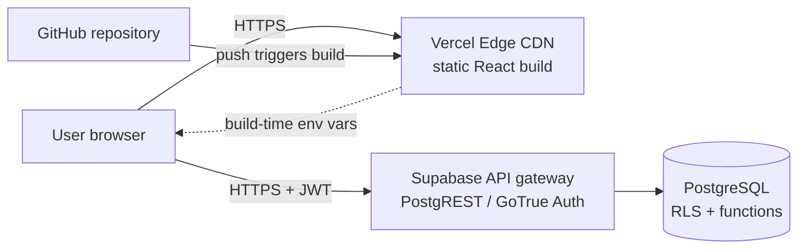
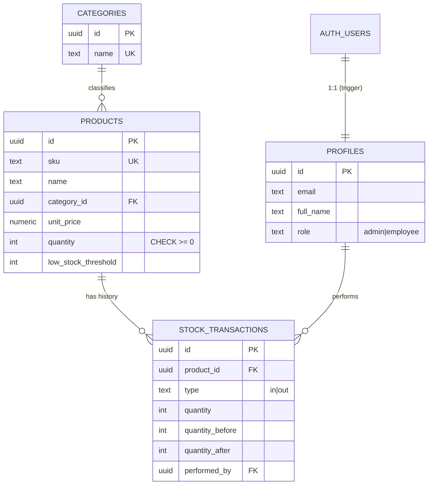

# Architecture and database design

## Cloud architecture

| Layer | Service | Responsibility |
|---|---|---|
| Source control | GitHub | Versioned code, SQL migrations, docs |
| Hosting / CDN | Vercel | Builds the Vite app, serves static files over HTTPS from a global CDN |
| Backend | Supabase (ap-south-1, Mumbai) | Managed PostgreSQL, authentication (JWT), auto-generated REST API |
| Authorization | PostgreSQL RLS + column grants + SECURITY DEFINER functions | The real security boundary |

There is no custom application server. The browser talks to Supabase directly with the **publishable key**; every
request carries the signed-in user's JWT, and PostgreSQL decides what that user may do.

## Entity-relationship diagram

## Design decisions

- **Normalized**: categories are their own table; transactions reference products and users by foreign key.
- **Integrity in the database**: CHECK constraints (`quantity >= 0`, `unit_price >= 0`, valid `type`, and
  `quantity_after = quantity_before ± quantity`), unique SKU, foreign keys with explicit `ON DELETE` behaviour.
- **Ledger style**: each `stock_transactions` row stores before/after balances, so the history can be audited and
  reconciled against `products.quantity`.
- **Safe stock updates**: `record_stock_movement()` locks the product row (`SELECT ... FOR UPDATE`), validates the
  request, updates the quantity and inserts the ledger row in one transaction. Two concurrent stock-outs cannot
  oversell. Clients cannot update `quantity` or insert transactions directly (column privileges + no INSERT policy).
- **Indexes**: foreign keys, `lower(name)`, `(quantity, low_stock_threshold)` and `(product_id, created_at desc)`.
- **Product delete cascades** to its transactions (documented trade-off; a production system might soft-delete instead).

## Roles

| Capability | Administrator | Employee |
|---|---|---|
| View dashboard, products, history | yes | yes |
| Record stock in / out | yes | yes |
| Create / edit / delete products and categories | yes | no |
| Change user roles | yes (cannot demote last admin) | no |

The first account created becomes the administrator (trigger `handle_new_user`); later accounts are employees.
